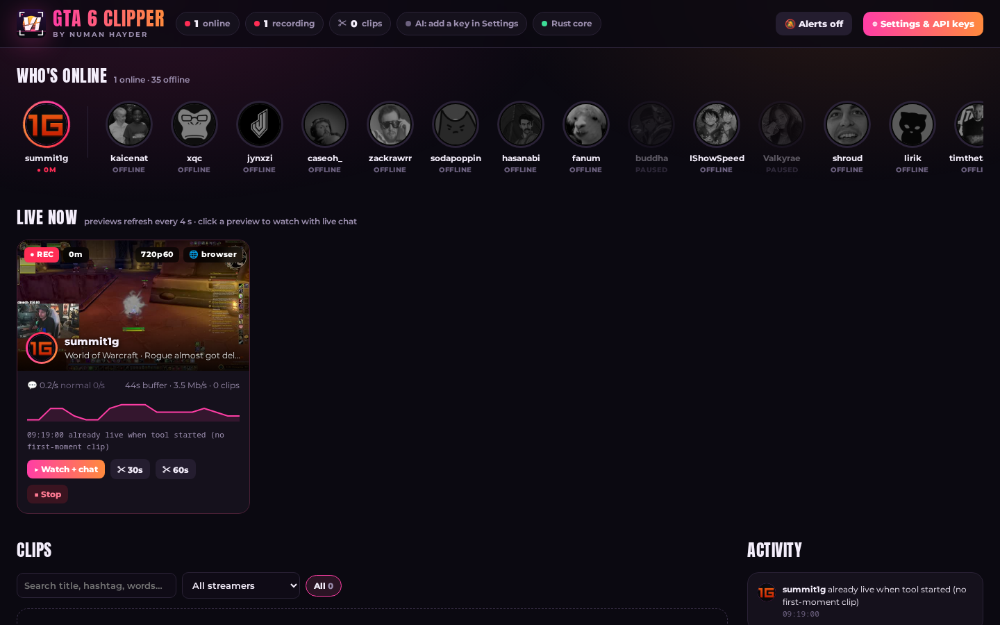

<p align="center">
  
</p>

<h1 align="center">GTA 6 Clipper</h1>
<p align="center"><b>Clipper by Numan Hayder for GTA 6</b><br>
Watches Twitch and YouTube streamers, records them while they are live, and turns the best moments into captioned 9:16 clips within a minute or two of them happening.</p>

<p align="center">
  
</p>

## Quick start

```bash
git clone https://github.com/byte4day/gta6-clipper && cd gta6-clipper
./gtaclip-run run          # first run installs everything, then opens the dashboard
```

Open **http://127.0.0.1:8787**, then in **⚙ Settings** paste a free [Groq](https://console.groq.com/keys) key.
Groq gives AI titles, AI moment detection and fast transcription. The clipper works without a key, but AI features are off.

**Needs:** Linux or macOS, Python 3.12 + [uv](https://docs.astral.sh/uv/), `ffmpeg`. Optional: Rust (`cargo`) for the fast core.

```bash
./gtaclip-run run --only xqc @IShowSpeed   # just a few streamers (@name = YouTube)
./gtaclip-run clip-file video.mp4           # make a clip from a file you already have
./gtaclip-run test-ai                       # check which AI providers answer
.venv/bin/python -m pytest -q tests         # Python tests
cargo test --manifest-path core/Cargo.toml  # Rust tests
```

## What it clips

| Trigger | How it's detected |
|---|---|
| 🔴 Stream start | the streamer goes live while the clipper runs: the first 75 s |
| 🌴 First time in GTA 6 | the category or title matches GTA VI for the first time (remembered forever) |
| 💬 Chat peak | chat runs 3× faster than normal, or a flood of hype words ("clip it", KEKW, W…) |
| 🔊 Loud moment | a scream: loudness jumps 12 dB or more above the running average |
| 🤖 AI moment | every 40 s the last 30 s of speech and chat are scored 0–10 by an LLM; ≥ 8 is clipped |
| ✂ Manual | buttons in the dashboard: clip the last 15 / 30 / 60 / 90 s |

Every clip gets Whisper word timings, an AI title, hook, caption and hashtags, and a vertical render with a blurred background, word-by-word animated captions (`gta`, `bold`, `mrbeast`, `minimal`), a hook box, the streamer's @, a progress bar, and audio levelled to −14 LUFS.

## Dashboard

- **Who's online:** 36 streamers out of the box, with real avatars. A red ring means live; the ring spins while recording.
- **Live now:** a preview per stream, refreshed every 4 s, with REC / AD / quality badges, a chat-speed graph, ✂ buttons, **Record anyway** and **■ Stop**.
- **Watch + chat:** play the recording next to the real live chat, and clip from there.
- **Clips:** hover to play; filter by streamer or trigger; search titles, hashtags and spoken words; **🗑 delete** right from the card.
- **Clip editor:** edit the title, hook, caption and hashtags; re-render with another caption style; copy the post text; download vertical, landscape or raw; delete.
- **Settings:** API keys, streamers (add / pause / remove), recording mode, quality, detection thresholds. All saved instantly.

## How it works

```
 channel pages ──► gtacore live (Rust, all streamers in ~1 s) ──► only live ones get a full streamlink probe
                                                                   │
 Twitch: headless Chrome finds the HLS playlist ──► our puller (skips ads) ──► ffmpeg ──► 4 s .ts ring buffer (6 min)
 YouTube: streamlink ─────────────────────────────────────────────────────────┘          │
                                                                                          ├─► gtacore tsdur (segment timing)
 Twitch chat ──► gtacore chat (ONE socket for every channel) ──► chat spikes             ├─► loudness ──► loud moments
 YouTube chat ──► headless Chrome pop-out chat                                            └─► cut ──► Whisper ──► LLM ──► ffmpeg render
```

### The Rust core (`core/`)

`gtacore` is a small native binary for the parts that run all the time. The launcher builds it automatically when `cargo` is installed. Without it, everything falls back to Python.

| Job | Before (Python) | With `gtacore` |
|---|---|---|
| Live check of 36 streamers | 36 streamlink processes every 45 s | one parallel HTTP pass, ~1 s, every 20 s |
| Segment duration | one `ffprobe` per segment (~130 ms) | PTS parsed in-process (~5 ms, matches ffprobe to < 1 ms) |
| Twitch chat | one thread + socket per channel | one IRC socket for every channel |

Going live is also noticed faster: the 20 s Rust check wakes a streamer's watcher right away.

## Configuration

`config.toml` holds the defaults and the streamer list. Changes made in the dashboard go to `state/settings.json` and win over `config.toml`.
API keys live in `.env` (chmod 600, never committed). AI providers are tried in order and all have free tiers:
Groq → OpenRouter → Cerebras → Gemini → Mistral. Without any key, built-in templates write the titles.

Useful settings:

- `record_mode = "gta_only"`: only record while the category or title is GTA 6. This saves bandwidth after launch day.
- `max_recordings = 6`: cap on parallel recordings (about 3–5 Mbit/s each at 720p60).
- `live_check_seconds = 20`: how often the Rust core checks every channel.

## Output

`clips/<streamer>/<time>_<trigger>/` contains `final_vertical.mp4`, `raw.mp4`, `post.txt` (ready to paste), `meta.json`, `transcript.json` and `thumb.jpg`.

## Notes

- "Stream start" clips need the clipper to be running before the streamer goes live.
- Respect each platform's terms and each streamer's clip policy before you post clips.
- Fonts in `assets/fonts` are OFL / Apache 2.0 (Google Fonts).

## Project page

`docs/index.html` is a static project page. To publish it, turn on GitHub Pages from the `docs/` folder.

## License

MIT © Numan Hayder
