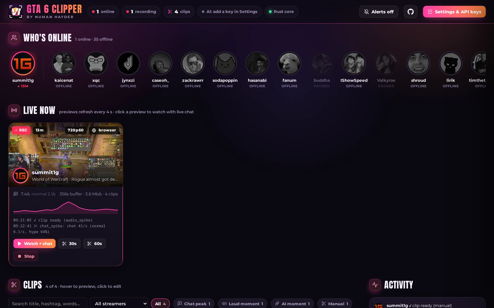
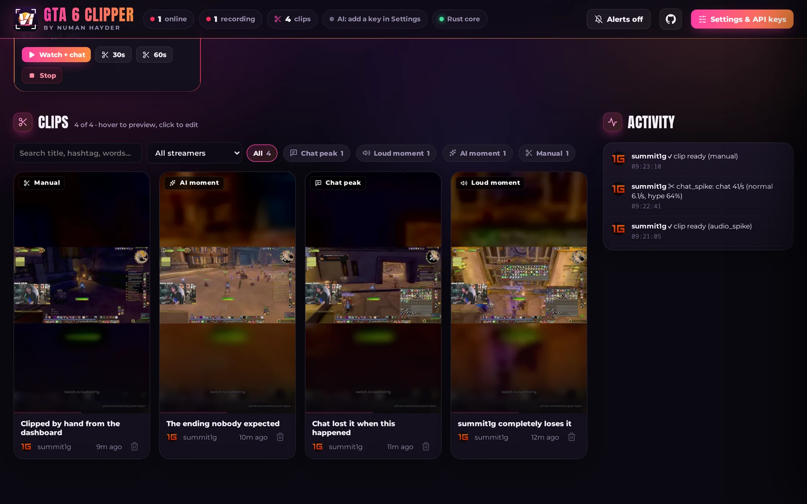
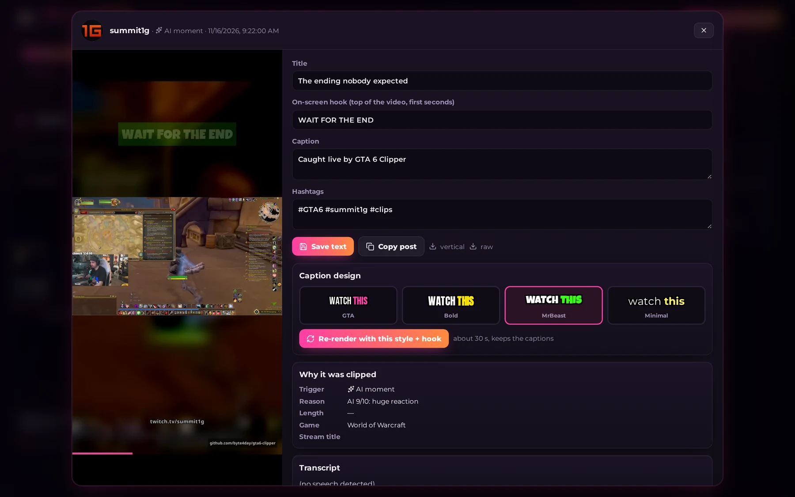
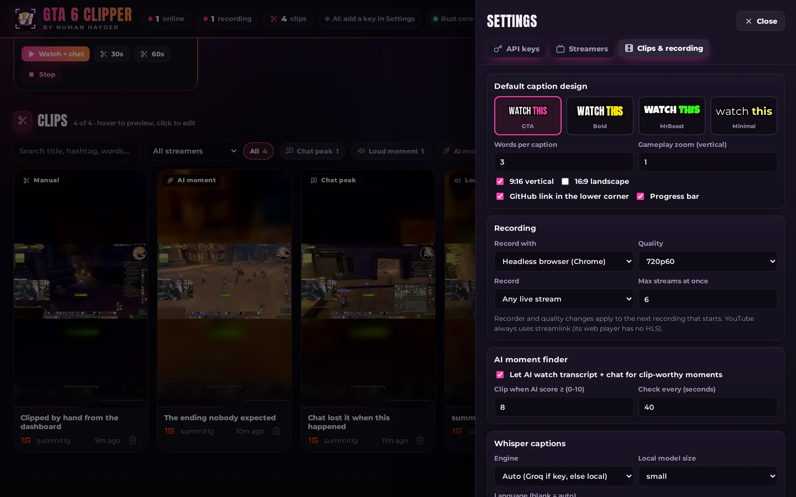

<div align="center">



<br><br>

<a href="#-start"></a>    

<h3>Watches Twitch and YouTube streamers, records them while they are live,<br>and turns the best moments into captioned 9:16 clips within a minute or two.</h3>


</div>

<br>

<a id="-start"></a>




```bash
git clone https://github.com/byte4day/gta6-clipper && cd gta6-clipper
./gtaclip-run run          # first run installs everything, then opens the dashboard
```

1. Open **http://127.0.0.1:8787**
2. In **⚙ Settings**, paste a free [Groq](https://console.groq.com/keys) key (AI titles, AI moment detection, fast transcription)
3. Leave it running. Clips land in the dashboard as they happen.

> [!NOTE]
> **Needs:** Linux or macOS, Python 3.12 + [uv](https://docs.astral.sh/uv/), `ffmpeg`. Optional: Rust (`cargo`) for the fast core.
> Without an AI key the clipper still works; AI features are off.

<details>
<summary><b>More commands</b></summary>

```bash
./gtaclip-run run --only xqc @IShowSpeed   # just a few streamers (@name = YouTube)
./gtaclip-run clip-file video.mp4           # make a clip from a file you already have
./gtaclip-run test-ai                       # check which AI providers answer
.venv/bin/python -m pytest -q tests         # Python tests
cargo test --manifest-path core/Cargo.toml  # Rust tests
```

</details>

<br>


<table>
<tr>
<td width="33%" valign="top"><h3>🔴 Stream start</h3>The streamer goes live while the clipper runs: the first 75 s.</td>
<td width="33%" valign="top"><h3>🌴 First time in GTA 6</h3>Category or title matches GTA VI for the first time. Remembered forever.</td>
<td width="33%" valign="top"><h3>💬 Chat peak</h3>Chat runs 3× faster than normal, or floods with hype words (“clip it”, KEKW, W…).</td>
</tr>
<tr>
<td valign="top"><h3>🔊 Loud moment</h3>A scream: loudness jumps 12 dB or more above the running average.</td>
<td valign="top"><h3>🤖 AI moment</h3>Every 40 s an LLM scores the last 30 s of speech and chat, 0–10. 8 or more is clipped.</td>
<td valign="top"><h3>✂ Manual</h3>Dashboard buttons clip the last 15 / 30 / 60 / 90 s.</td>
</tr>
</table>

Every clip gets Whisper word timings, an AI title, hook, caption and hashtags, and a vertical render with a blurred background, word-by-word animated captions (`gta`, `bold`, `mrbeast`, `minimal`), a hook box, the streamer's @, a progress bar, and audio levelled to −14 LUFS.

<br>


<p align="center"></p>

- **Who's online:** 36 streamers out of the box, with real avatars. A red ring means live; the ring spins while recording.
- **Live now:** a preview per stream, refreshed every 4 s, with REC / AD / quality badges, a chat-speed graph, ✂ buttons, **Record anyway** and **■ Stop**.
- **Watch + chat:** play the recording next to the real live chat, and clip from there.

<table>
<tr>
<td width="50%"></td>
<td width="50%"></td>
</tr>
<tr>
<td valign="top"><b>Clips:</b> hover to play; filter by streamer or trigger; search titles, hashtags and spoken words; 🗑 delete from the card.</td>
<td valign="top"><b>Clip editor:</b> edit title, hook, caption and hashtags; re-render in another caption style; copy the post; download vertical, landscape or raw.</td>
</tr>
</table>

<details>
<summary><b>Settings page</b></summary>
<br>


API keys, streamers (add / pause / remove), recording mode, quality, detection thresholds. All saved instantly.
</details>

<br>


```
 channel pages ──► gtacore live (Rust, all streamers in ~1 s) ──► only live ones get a full streamlink probe
                                                                   │
 Twitch: headless Chrome finds the HLS playlist ──► our puller (skips ads) ──► ffmpeg ──► 4 s .ts ring buffer (6 min)
 YouTube: streamlink ─────────────────────────────────────────────────────────┘          │
                                                                                          ├─► gtacore tsdur (segment timing)
 Twitch chat ──► gtacore chat (ONE socket for every channel) ──► chat spikes             ├─► loudness ──► loud moments
 YouTube chat ──► headless Chrome pop-out chat                                            └─► cut ──► Whisper ──► LLM ──► ffmpeg render
```

<br>


`gtacore` (in `core/`) is a small native binary for the parts that run all the time. The launcher builds it automatically when `cargo` is installed. Without it, everything falls back to Python.

| Job | Before (Python) | With `gtacore` |
|---|---|---|
| Live check of 36 streamers | 36 streamlink processes every 45 s | one parallel HTTP pass, ~1 s, every 20 s |
| Segment duration | one `ffprobe` per segment (~130 ms) | PTS parsed in-process (~5 ms, matches ffprobe to < 1 ms) |
| Twitch chat | one thread + socket per channel | one IRC socket for every channel |

Going live is also noticed faster: the 20 s Rust check wakes a streamer's watcher right away.

<br>


`config.toml` holds the defaults and the streamer list. Changes made in the dashboard go to `state/settings.json` and win over `config.toml`.
API keys live in `.env` (chmod 600, never committed). AI providers are tried in order on **free-tier models only**:
**Groq (`openai/gpt-oss-20b`) → OpenRouter (`*:free`) → Cerebras → Gemini → Mistral**. OpenRouter never falls through to paid models. Without any key, built-in templates write the titles.

| Setting | What it does |
|---|---|
| `record_mode = "gta_only"` | only record while the category or title is GTA 6; saves bandwidth after launch day |
| `max_recordings = 6` | cap on parallel recordings (about 3–5 Mbit/s each at 720p60) |
| `live_check_seconds = 20` | how often the Rust core checks every channel |
| `socials.auto_upload` | after each clip, push to connected YouTube / TikTok / Instagram accounts |

**Socials:** in **⚙ Settings → Socials**, paste each platform’s app client id/secret (see `.env.example`), click **Connect**, and leave `auto_upload` on. Finished vertical clips post with the AI title, caption and hashtags. You can also hit **Upload now** in the clip editor. OAuth redirect URI is `http://127.0.0.1:8787/api/socials/callback/<platform>`.

**Output:** `clips/<streamer>/<time>_<trigger>/` holds `final_vertical.mp4`, `raw.mp4`, `post.txt` (ready to paste), `meta.json`, `transcript.json` and `thumb.jpg`.

> [!IMPORTANT]
> "Stream start" clips need the clipper running before the streamer goes live.
> Respect each platform's terms and each streamer's clip policy before you post clips.

<br>

<div align="center">


<sub>Fonts in <code>assets/fonts</code> are OFL / Apache 2.0 (Google Fonts). README art is generated by <code>assets/readme/make.py</code>. <code>docs/index.html</code> is a static project page for GitHub Pages.</sub>

<b>MIT © Numan Hayder</b>
</div>
